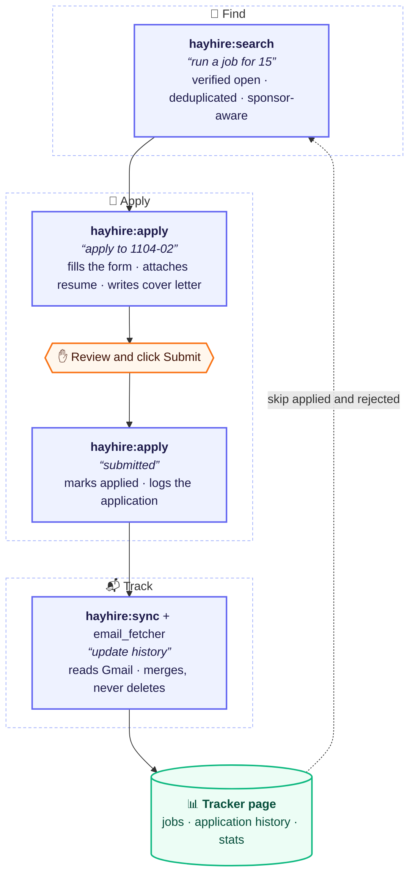

# HayHire

**Finds the needle in the job haystack, and leaves Submit to you.**

*A Claude Code agent harness: job search → apply → email tracking.*

An AI-agent workflow, packaged as a Claude Code plugin, that finds entry-level jobs in the places you choose (with US visa sponsorship checks when you need them), verifies each one is open on the company's own site, fills applications for human review, and tracks every response from Gmail. A small **harness** connects the steps end to end, and the agent never submits anything: a person reviews every application and clicks Submit.

This repo holds the skills and the harness. The Gmail side lives in its own repo, [email_fetcher](https://github.com/Ari-Da/email_fetcher).

## Demo

<!-- DEMO VIDEO: on github.com, edit this file and drag the .mp4 onto this line -->

*All names, companies and numbers below are sample data.*

<p><b>1. Set up once</b>: share your resume, confirm what it found with a click, and your private tracker is created</p>

<picture>
  <source media="(prefers-color-scheme: dark)" srcset="docs/images/dark-0-setup.png">
  
</picture>

<br>

<p><b>2. Find</b>: jobs that match your profile, each checked on the company's own site</p>

<picture>
  <source media="(prefers-color-scheme: dark)" srcset="docs/images/dark-1-job-search.png">
  
</picture>

<br>

<p><b>3. Apply</b>: the agent fills the form and suggests a salary, a person clicks Submit</p>

<picture>
  <source media="(prefers-color-scheme: dark)" srcset="docs/images/dark-2-apply.png">
  
</picture>

<br>

<p><b>4. Track</b>: replies read from email, merged, never deleted</p>

<picture>
  <source media="(prefers-color-scheme: dark)" srcset="docs/images/dark-3-history.png">
  
</picture>

<br>

<p><b>5. Outreach</b>: recruiter emails and who wrote back</p>

<picture>
  <source media="(prefers-color-scheme: dark)" srcset="docs/images/dark-4-outreach.png">
  
</picture>

## How it fits together



Gmail is only ever read. The tracker page is a Claude artifact, private by default; its owner decides who else can see it.

## The harness

The `hayhire:pipeline` skill (`skills/pipeline`) is the harness. It does not do the work itself; it decides what runs next and owns the handoffs between the other skills:

| Step | Skill | Trigger | Writes |
|---|---|---|---|
| 1. Find jobs | `hayhire:search` | "run a job for 15" | new `jobs` rows |
| 2. Fill an application | `hayhire:apply` | "apply to 1104-02" | nothing |
| 3. Submit | the person, by hand | clicks Submit | |
| 4. Record it | `hayhire:apply` | "submitted", or found by itself on the next command (confirmation page) or after "update history" (confirmation email) | `applied` on the job, a history row |
| 5. Confirm from email | `hayhire:sync` | "update history" | history rows (merge, never delete) |
| 6. Recruiter stats | `hayhire:sync` | "update outreach" | outreach rows |

It also answers "pipeline status" and "next". See [harness/README.md](harness/README.md).

## Design decisions

- **Human in the loop.** The agent never clicks Submit, never accepts terms or consent boxes, never creates accounts and never types passwords. LinkedIn and Handshake are read-only.
- **Verified, not scraped.** Every job is confirmed open on the company's own careers site or ATS (Greenhouse, Ashby, Workday APIs), deduplicated across runs, and filtered by sponsorship and graduation-date rules.
- **Submissions are caught three ways.** Saying "submitted" (or ticking the job on the page) logs it at once. If the person says nothing, the next command checks the application's tab for a confirmation page, and "update history" checks for a confirmation email. A job is only marked applied on a clear sign, never a guess.
- **One writer per collection.** Job search adds jobs, the apply skill marks them and logs submissions, and the email sync only merges into the history. Nothing deletes history rows except the person, by hand.
- **Personal salary answers.** When a form asks for expected pay, `apply` fills in a figure for that job and that person, and explains it in a couple of lines. It starts from the posting's pay range (or public pay data for the same role and city when none is posted), then places the person in it by fit: their experience from the resume against the job's requirements and day-to-day responsibilities. There is no default to the low end, and the figure never goes outside the posted range. A salary rule saved at setup, such as a floor, always wins, and the person can change the figure before submitting.
- **Merge-only sync.** Confirmation emails are matched to logged submissions by company (subsidiaries included), role and date. Unclear matches go to a needs-review list instead of being guessed, and a status only ever moves forward.
- **Privacy first.** Gmail access is read-only and the scope is checked on every token. Recruiter emails are classified by a small local model (Ollama, `llama3.2:3b`), so email text never leaves the machine.

More in [docs/design-decisions.md](docs/design-decisions.md).

## Getting started

HayHire is a Claude Code plugin. Install it from inside Claude Code:

```text
/plugin marketplace add Ari-Da/hayhire-agent
/plugin install hayhire@hayhire
```

On Claude Code 2.1.275 or later, one line does both: `/plugin install hayhire --marketplace Ari-Da/hayhire-agent`. Then run `/reload-plugins` (or start a new session) and say **"set up job agent"** to answer the [setup questionnaire](#setup-questionnaire). Setup first creates your private folder, `~/job-agent/private`, without asking anything; nothing else needs to be cloned or run.

For email tracking (optional), clone the Gmail side next to it:

```bash
git clone https://github.com/Ari-Da/email_fetcher.git ~/job-agent/email_fetcher
```

**Why a plugin.** All seven skills live under one name, `hayhire:`, so they never clash with other skills, for example an older job kit with its own `job-search` or `apply`. Setup also looks for other job skills that could answer the same requests and offers to move them aside (it never deletes them).

| Skill | Run it by saying | or |
|---|---|---|
| `hayhire:setup` | "set up job agent", "update my resume", "back up my job data" | `/hayhire:setup` |
| `hayhire:search` | "run a job for 15" | `/hayhire:search 15` |
| `hayhire:apply` | "apply to 1104-02", "submitted" | `/hayhire:apply 1104-02` |
| `hayhire:cover-letter` | "cover letter for 1104-02" | `/hayhire:cover-letter` |
| `hayhire:sync` | "update history" | `/hayhire:sync` |
| `hayhire:pipeline` | "pipeline status", "next" | `/hayhire:pipeline` |
| `hayhire:help` | "help", "help apply" | `/hayhire:help` |

**Updates** come from `/plugin` (Installed, HayHire, Update) or `claude plugin update hayhire@hayhire`, then `/reload-plugins`. Your private folder is never touched by an update.

**Working on the code?** Clone this repo into `~/job-agent/public` and run `sh public/install.sh` instead of the plugin commands. It links your clone at `~/.claude/skills/hayhire`, which Claude Code loads as the plugin (`hayhire@skills-dir`), so your edits apply in the next session. Use one or the other, not both.

**Choose a browser for applying.** The first time you apply, `hayhire:apply` asks where to fill in forms: Chrome with the Claude extension, or Claude's built-in browser. It only offers what works on your computer, and checks for the extension only if you pick Chrome. Every form still stops before Submit for review.

| Browser | Needs | Resume and cover letter | Good for |
|---|---|---|---|
| **Your own Chrome** (`chrome`) | the [Claude in Chrome](https://claude.com/chrome) extension, connected to your Claude account. Edge and other Chromium browsers may work through Claude Code, but only Chrome is officially supported | uploaded by the agent | the most hands-off option; uses your existing sign-ins |
| **The Claude app's built-in browser** (`built-in`) | the Claude desktop app, nothing to install | **you upload them**: the agent prepares the files and tells you which goes where | no extension; fills everything else |

**Firefox or Safari?** There is no Claude extension for them, so choose the built-in browser. Change it any time by saying "set up job agent". On each platform:

| Platform | What `apply` does |
|---|---|
| Greenhouse, Ashby, Lever | Fills the whole form, no sign-in needed (with the built-in browser, you add the files) |
| Workday, iCIMS, Oracle, SuccessFactors and other portals with accounts | Needs a manual sign-in (or new account) first, in that same browser; then it fills the rest |
| LinkedIn, Handshake | Read-only: used to find jobs, never to apply (no Easy Apply) |

Consent boxes, CAPTCHAs and passwords are always done by hand. With neither browser (for example Claude Code in a plain terminal), automatic applying does not work, and setup says so. Everything else still works: job search, cover letters, the tracker and email tracking, and "submitted" still logs applications made by hand.

The tracker page is a Claude artifact that setup creates for you, private, from [tracker/tracker.html](tracker/tracker.html) (see [Sharing the tracker](#sharing-the-tracker) to change that).

```text
~/job-agent/
  private/         your answers, resumes and records; never in any repo
  email_fetcher/   optional: the Gmail side, its own repo
  public/          only if you cloned this repo to work on it
```

The skills are the same files that are published here: they read your details from `private/` (through the link `~/.claude/job-agent-private`, using `config.json` and `notes/<skill>.md`), so nothing personal is written into them. The plugin's own files sit in Claude Code's plugin folder and are replaced on every update, so nothing personal is kept there.

## Setup questionnaire

Setup starts from your resume, so there is little to type:

1. **Share your resume.** Drop the PDF into the chat, or type skip to enter your details by hand. It is saved in your private folder, and it is the file `apply` uploads.
2. **Check what it found.** The agent fills in your contact details, education, work history, projects and skills from the resume, and shows one section at a time in a question box, one field per line (FIRST NAME, LAST NAME, EMAIL and so on). You click **Correct**, click **Incorrect** to fix it field by field, or type the fix under **Other** ("COMPANY: Acme; DATES: 2023 – 2025"), and it is applied at once. Sections with several entries, such as two degrees, are numbered, so a fix can say which one ("#1 DATES: Sep 2024 – May 2026"). Nothing is guessed: every link on the resume is kept, and one that is not there shows as "not on resume" without a question (type it as a fix if you want to add it), and a name that is not a clear first and last name, such as one with a middle name or two surnames, comes as a question with the likely splits.
3. **Answer the rest with clicks.** What a resume cannot show (roles, where to look, US visa needs if the US is one of them, how recent postings should be) comes as clickable questions in the chat, with an "Other" box for anything else. Anything typed is checked before it is saved: typos are fixed, regions such as "Bay Area" become real cities, unclear names are asked about, and you confirm the final list.

Answers are saved in `job-agent/private/`, outside every repo, and every skill reads them from there. Setup only asks what finding the right jobs needs, so it takes a few minutes. Everything else (start date, relocation, salary rule, self-identification, cover letters, browser) is asked the first time a form needs it, and remembered.

Start it with:

```text
set up job agent
```

Questions at setup:

| Topic | Example questions | Saved to |
|---|---|---|
| 📄 From your resume | Contact details, education, work history, projects and skills, read from the resume and confirmed one section at a time: Correct, Incorrect (fix field by field) or type the fix. | `apply/profile.md` |
| 🎓 Graduation | Only for current students: is the graduation date on the resume certain, or could it move? | `config.json` |
| 🎯 Roles and level | Which roles, in priority order? Which titles should never show up? The most years of experience a posting may ask for? | `notes/job-search.md` |
| 📍 Where to look | Anywhere in the world: which countries, regions or cities, in order (options come from your resume: the country you live in, a region tied to your resume such as Europe, another country you worked or studied in, and Anywhere)? Remote within those places, anywhere, or none? On-site, hybrid or remote? Typed places are checked ("Portland: Oregon or Maine?") and the final list is confirmed. | `notes/job-search.md` |
| 🛂 US work authorization | Asked only if you are looking in the US: do you need visa sponsorship now? In the future? Your current status (F-1 with OPT, H-1B, green card, citizen)? | `apply/profile.md` |
| 🗓️ How recent | How old can a posting be: last 7, 14 or 30 days? Any run can override it. | `notes/job-search.md` |
| 🏢 Companies *(optional)* | Any companies to check on every run, or to skip? | `notes/job-search.md` |
| ⚙️ Tracker | Nothing to answer: setup creates your private tracker page and saves its link. | `config.json` |

Asked later, the first time they are needed: start date or notice period, relocation, salary rule, self-identification, cover letters (voice, opening, experience paragraph), and which browser fills applications.

It never asks for passwords, ID numbers or bank details, and it never overwrites an earlier answer without asking. To change an answer later, say "set up job agent" again or just state the new rule. The full list is in [docs/setup-questionnaire.md](docs/setup-questionnaire.md).

**New resume?** Say **"update my resume"** and share the file. The agent asks whether it replaces the old one or is another version (for example one for ML roles), keeps the old file in `resume/archive/`, shows what changed and updates your profile after you confirm.

## Usage

```text
set up job agent            # first time: reads your resume, then clickable questions
update my resume            # swap in or add a resume version
run a job for 15            # up to 15 new verified jobs, as recent as your setup answer (default 14 days)
/hayhire:search 20 7        # up to 20 jobs posted in the last 7 days
job run startup 10          # Y Combinator startups that sponsor visas
apply to 1104-02            # fill job 1104-02 (salary suggested and explained) and stop before Submit
submitted                   # record it and add it to the history
update history              # read Gmail and merge new responses
pipeline status             # where everything stands
back up my job data         # export jobs, applications and outreach, pack your private data
uninstall hayhire           # optional backup, then remove the plugin
restore my job data         # bring a backup back after reinstalling
change my search            # change roles, places, or how recent postings must be
help                        # list every command and what it does (/hayhire:help)
```

These are the same with or without the plugin name. If another job kit is also installed and the wrong skill answers, start with "hayhire" ("hayhire, apply to 1104-02") or use the `/hayhire:` command.

## Tests

The Python lives in email_fetcher:

```bash
python -m unittest discover -s tests
```

## Limitations and ethics

- A personal tool for one person's own job search, run on their own computer.
- It respects site terms: it never automates submission, sign-in or account creation, and only reads LinkedIn and Handshake.
- Matching emails to applications is rule-based and sometimes wrong; unclear cases are left for the person to review.
- Companies that send no confirmation email, and replies by phone, are not tracked.

## Sharing the tracker

The tracker page is yours, and so is the choice of who sees it. It starts **private**, and one setting, `TRACKER_SHARING` in `private/config.json`, opens it up:

| Setting | Someone you share the link with sees |
|---|---|
| `private` *(default)* | the page, with no data |
| `applications` | jobs, application history and charts; recruiter outreach stays yours |
| `everything` | all of it, recruiter outreach included |

The setting becomes the page's database access rules, so the database enforces it; the data is not just hidden on the page. Rules cover whole tables, not single fields: shared history rows include the Gmail account address and a Gmail link (the link only opens for someone signed in to that mailbox). Share only with people you trust.

Two things decide what a viewer sees: the **Share** menu lets them open the page, and `TRACKER_SHARING` decides which data loads. To change it, say "set up job agent" and ask to change tracker sharing; the agent updates the setting and the page's rules together. The skills follow the setting and never stop a sync because a page is shared.

## Back up, uninstall and restore

Removing the agent and setting it up again takes three commands, and your jobs, applications and Insights can come back with it. That makes a clean end-to-end test easy too.

```text
back up my job data       # export the tracker and pack your private data
uninstall hayhire         # optional backup, then remove the plugin (and your data folder, if you choose)
restore my job data       # after installing the plugin again: bring it all back
```

**What a backup holds** (one archive in `~/hayhire-backups/`, readable only by you, outside the `job-agent` folder so it survives an uninstall):

| Part | Where it comes from |
|---|---|
| Jobs, application history, recruiter outreach | the tracker page on claude.ai, exported by Claude (Insights is drawn from these rows) |
| Your answers, notes, resumes, cover letters and application records | `private/` |
| Email tracking state and settings | `email_fetcher/data/`, `settings.json`, `credentials.json` |

Gmail login tokens are left out on purpose; you sign in again after a restore. The archive holds personal data: keep it on your computer, never in a repo.

**Uninstall** asks, with clicks, whether to back up first, whether to delete the tracker page (only after the backup succeeds), and whether to move your data folder to the Trash. It removes the plugin, the link to your private folder and links left by older installs, and nothing else: other skills, even ones with the same names, are left alone. The data folder goes to the Trash only if it holds nothing but HayHire's parts (`private`, `email_fetcher`, a clone); otherwise just `private/` goes, and the rest stays. Two things stay for you: removing the app's Gmail access at [myaccount.google.com/permissions](https://myaccount.google.com/permissions), and, for a truly fresh test, this project's Claude Code memory in `~/.claude/projects/`.

**Restore** picks a backup, puts your private files back (asking before replacing anything you have changed), writes the rows into your new tracker page, and refreshes the email sync's local copy so nothing is added twice.

From a clone, the scripts also work without Claude: `sh public/backup.sh` makes the archive (without the tracker rows), and `sh public/uninstall.sh` removes everything above (`--help` for options). Running `sh public/install.sh` again is safe: it replaces links left by an older install and tells you when it finds a backup.

**Upgrading from an install before the plugin** (one link per skill in `~/.claude/skills`): install the plugin, then say "set up job agent". Setup finds the old links and offers to remove them, and keeps your private folder and answers as they are. From a clone, `sh public/install.sh` does the same.

## Keeping it private

This section is about the code: nothing personal ever goes into this repo, whatever the tracker setting.

`scripts/check_private.py` scans every file and the whole git history against `private/blocklist.txt`, which lives outside the repo, and runs before each commit and push (`scripts/install_hooks.sh`).
