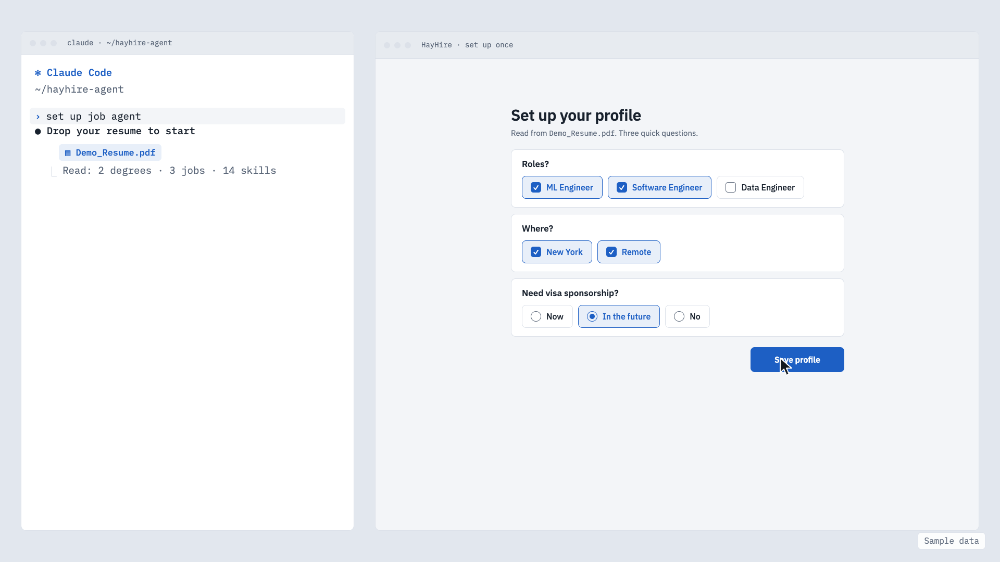
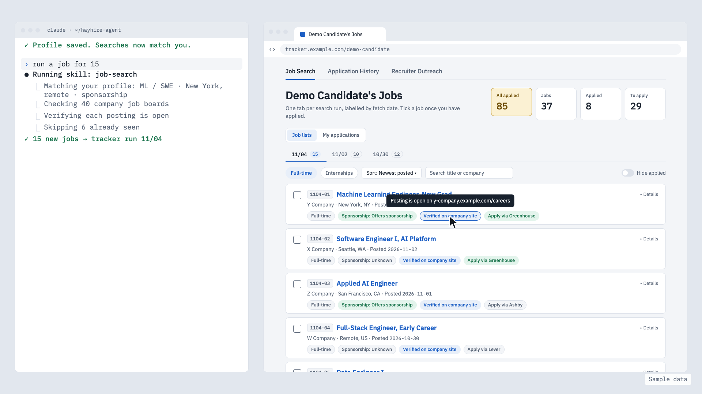
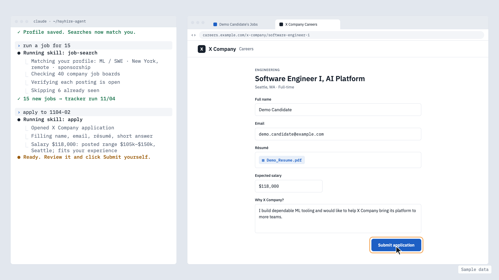
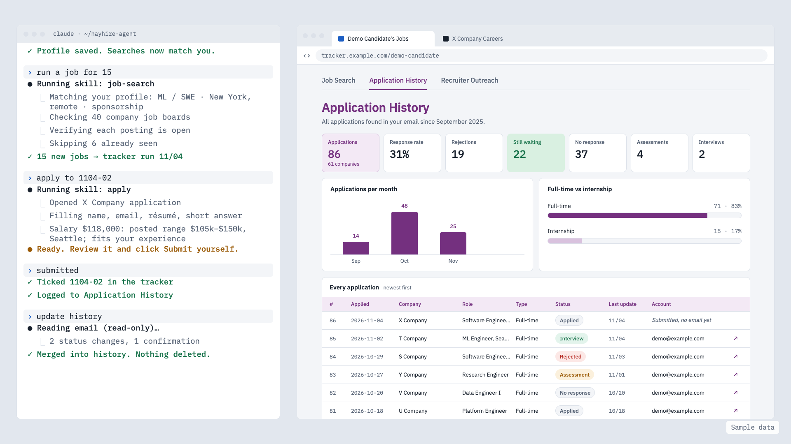
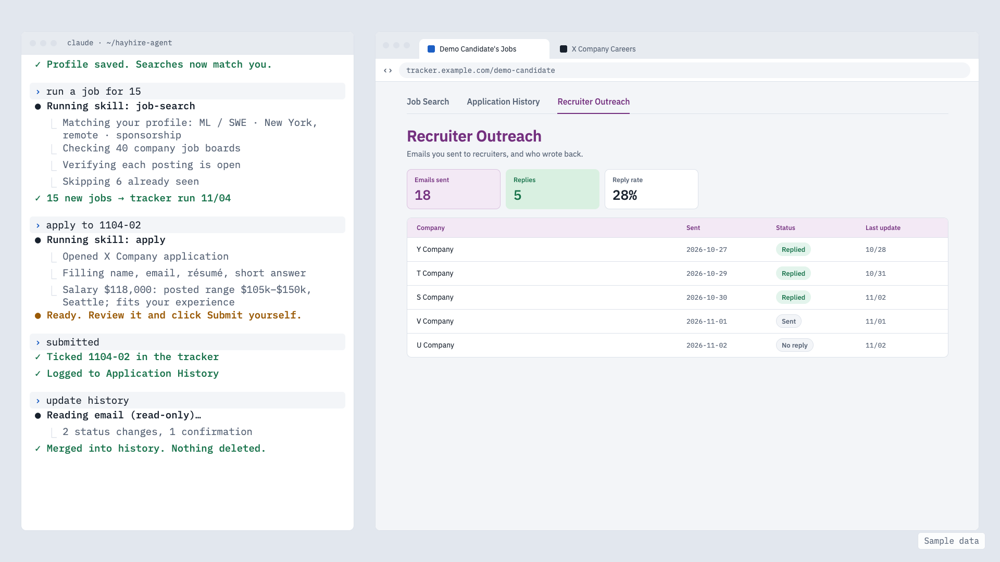
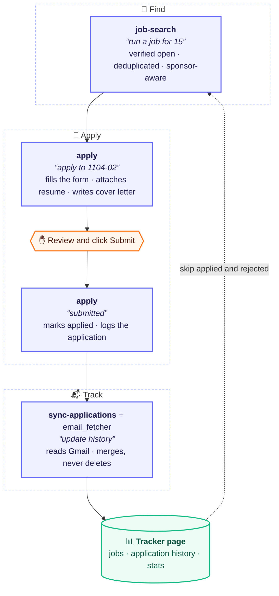

# HayHire

**Finds the needle in the job haystack, and leaves Submit to you.**

*A Claude Code agent harness: job search → apply → email tracking.*

An AI-agent workflow, built on Claude Code skills, that finds visa-friendly entry-level jobs, verifies each one is open on the company's own site, fills applications for human review, and tracks every response from Gmail. A small **harness** connects the steps end to end, and the agent never submits anything: a person reviews every application and clicks Submit.

This repo holds the skills and the harness. The Gmail side lives in its own repo, [email_fetcher](https://github.com/Ari-Da/email_fetcher).

## Demo

<!-- DEMO VIDEO: on github.com, edit this file and drag the .mp4 onto this line -->

*All names, companies and numbers below are sample data.*

<p><b>1. Set up once</b>: your resume plus a few clicks becomes your profile</p>

<picture>
  <source media="(prefers-color-scheme: dark)" srcset="docs/images/dark-0-setup.png">
  
</picture>

<br>

<p><b>2. Find</b>: jobs that match your profile, each checked on the company's own site</p>

<picture>
  <source media="(prefers-color-scheme: dark)" srcset="docs/images/dark-1-job-search.png">
  
</picture>

<br>

<p><b>3. Apply</b>: the agent fills the form and suggests a salary, a person clicks Submit</p>

<picture>
  <source media="(prefers-color-scheme: dark)" srcset="docs/images/dark-2-apply.png">
  
</picture>

<br>

<p><b>4. Track</b>: replies read from email, merged, never deleted</p>

<picture>
  <source media="(prefers-color-scheme: dark)" srcset="docs/images/dark-3-history.png">
  
</picture>

<br>

<p><b>5. Outreach</b>: recruiter emails and who wrote back</p>

<picture>
  <source media="(prefers-color-scheme: dark)" srcset="docs/images/dark-4-outreach.png">
  
</picture>

## How it fits together



Gmail is only ever read. The tracker page is a Claude artifact, private by default; its owner decides who else can see it.

## The harness

`skills/job-pipeline` is the harness. It does not do the work itself; it decides what runs next and owns the handoffs between the other skills:

| Step | Skill | Trigger | Writes |
|---|---|---|---|
| 1. Find jobs | `job-search` | "run a job for 15" | new `jobs` rows |
| 2. Fill an application | `apply` | "apply to 1104-02" | nothing |
| 3. Submit | the person, by hand | clicks Submit | |
| 4. Record it | `apply` | "submitted", or found by itself on the next command (confirmation page) or after "update history" (confirmation email) | `applied` on the job, a history row |
| 5. Confirm from email | `sync-applications` | "update history" | history rows (merge, never delete) |
| 6. Recruiter stats | `sync-applications` | "update outreach" | outreach rows |

It also answers "pipeline status" and "next". See [harness/README.md](harness/README.md).

## Design decisions

- **Human in the loop.** The agent never clicks Submit, never accepts terms or consent boxes, never creates accounts and never types passwords. LinkedIn and Handshake are read-only.
- **Verified, not scraped.** Every job is confirmed open on the company's own careers site or ATS (Greenhouse, Ashby, Workday APIs), deduplicated across runs, and filtered by sponsorship and graduation-date rules.
- **Submissions are caught three ways.** Saying "submitted" (or ticking the job on the page) logs it at once. If the person says nothing, the next command checks the application's tab for a confirmation page, and "update history" checks for a confirmation email. A job is only marked applied on a clear sign, never a guess.
- **One writer per collection.** Job search adds jobs, the apply skill marks them and logs submissions, and the email sync only merges into the history. Nothing deletes history rows except the person, by hand.
- **Personal salary answers.** When a form asks for expected pay, `apply` fills in a figure for that job and that person, and explains it in a couple of lines. It starts from the posting's pay range (or public pay data for the same role and city when none is posted), then places the person in it by fit: their experience from the resume against the job's requirements and day-to-day responsibilities. There is no default to the low end, and the figure never goes outside the posted range. A salary rule saved at setup, such as a floor, always wins, and the person can change the figure before submitting.
- **Merge-only sync.** Confirmation emails are matched to logged submissions by company (subsidiaries included), role and date. Unclear matches go to a needs-review list instead of being guessed, and a status only ever moves forward.
- **Privacy first.** Gmail access is read-only and the scope is checked on every token. Recruiter emails are classified by a small local model (Ollama, `llama3.2:3b`), so email text never leaves the machine.

More in [docs/design-decisions.md](docs/design-decisions.md).

## Getting started

```bash
mkdir job-agent && cd job-agent
git clone https://github.com/Ari-Da/hayhire-agent.git public
git clone https://github.com/Ari-Da/email_fetcher.git      # optional: email tracking
./public/install.sh
```

Then open Claude Code and say **"set up job agent"** to answer the [setup questionnaire](#setup-questionnaire).

**Choose a browser for applying.** Setup asks which browser the `apply` skill should fill forms in. It first checks whether Claude in Chrome is already connected, and only offers what works on your computer. Every form still stops before Submit for review.

| Browser | Needs | Resume and cover letter | Good for |
|---|---|---|---|
| **Your own Chrome** (`chrome`) | the [Claude in Chrome](https://claude.com/chrome) extension, connected to your Claude account. Edge and other Chromium browsers may work through Claude Code, but only Chrome is officially supported | uploaded by the agent | the most hands-off option; uses your existing sign-ins |
| **The Claude app's built-in browser** (`built-in`) | the Claude desktop app, nothing to install | **you upload them**: the agent prepares the files and tells you which goes where | no extension; fills everything else |

**Firefox or Safari?** There is no Claude extension for them, so choose the built-in browser. Change it any time by saying "set up job agent". On each platform:

| Platform | What `apply` does |
|---|---|
| Greenhouse, Ashby, Lever | Fills the whole form, no sign-in needed (with the built-in browser, you add the files) |
| Workday, iCIMS, Oracle, SuccessFactors and other portals with accounts | Needs a manual sign-in (or new account) first, in that same browser; then it fills the rest |
| LinkedIn, Handshake | Read-only: used to find jobs, never to apply (no Easy Apply) |

Consent boxes, CAPTCHAs and passwords are always done by hand. With neither browser (for example Claude Code in a plain terminal), automatic applying does not work, and setup says so. Everything else still works: job search, cover letters, the tracker and email tracking, and "submitted" still logs applications made by hand.

The tracker page is a Claude artifact; setup asks for its link and who may see it (see [Sharing the tracker](#sharing-the-tracker)).

```text
job-agent/
  public/          this repo: skills, harness, docs, examples (all public)
  email_fetcher/   the Gmail side, its own repo
  private/         your answers, resumes and records; never in any repo
```

The skills are the same files that are published here: they read your details from `private/` (`config.json` and `notes/<skill>.md`), so nothing personal is written into them.

## Setup questionnaire

Setup starts from your resume, so there is little to type:

1. **Share your resume.** Drop the PDF into the chat. It is saved in your private folder, and it is the file `apply` uploads.
2. **Check what it found.** The agent fills in your contact details, education, work history and skills from the resume, and you confirm or fix each section with a click.
3. **Answer the rest with clicks.** What a resume cannot show (sponsorship, roles, locations, browser, tracker sharing) comes as clickable questions in the chat, with an "Other" box for anything else. Anything typed is checked before it is saved: typos are fixed, regions such as "Bay Area" become real cities, unclear names are asked about, and you confirm the final list.

Answers are saved in `job-agent/private/`, outside every repo, and every skill reads them from there. The quick start takes about 5 minutes; the rest can wait, because `apply` asks when a form needs something missing and remembers the answer.

Start it with:

```text
set up job agent
```

Sample questions:

| Topic | Example questions | Saved to |
|---|---|---|
| 📄 From your resume | Contact details, education, work history and skills, read from the resume. "3 jobs found, the latest Example Corp, Software Engineer. Right?" | `apply/profile.md` |
| 👤 About you | Preferred name? Which link goes in a single "links" field? Any salary rule, such as a floor? (optional: by default each job gets its own suggested figure) | `apply/profile.md` |
| 🛂 Work authorization | Do you need visa sponsorship now? In the future? Does student work permission count as sponsorship? | `apply/profile.md` |
| 🎓 Graduation | Is the graduation date on the resume certain, or could it move? | `apply/profile.md` |
| 🎯 Roles and level | Which roles, in priority order? Which titles should never show up? The most years of experience a posting may ask for? | `notes/job-search.md` |
| 📍 Location | Which cities, in order? Remote: US, Europe, anywhere, or none (or type another region)? On-site, hybrid or remote? Typed places are checked ("Portland: Oregon or Maine?") and the final list is confirmed. | `notes/job-search.md` |
| 🏢 Companies | Which companies should be checked on every run? Any to skip? | `notes/job-search.md` |
| ✉️ Cover letter *(optional)* | Skip it if no cover letters are wanted. Otherwise: formal, warm or concise? The opening line and experience paragraph? Products genuinely used, for a true personal tie? | `cover-letter/facts.json` |
| ⚙️ Setup | The tracker page link, and who may see it? Apply in your own Chrome (with the extension) or the built-in browser? Words that must never be published? | `config.json`, `browsers.json`, `blocklist.txt` |

It never asks for passwords, ID numbers or bank details, and it never overwrites an earlier answer without asking. To change an answer later, say "set up job agent" again or just state the new rule. The full list is in [docs/setup-questionnaire.md](docs/setup-questionnaire.md).

**New resume?** Say **"update my resume"** and share the file. The agent asks whether it replaces the old one or is another version (for example one for ML roles), keeps the old file in `resume/archive/`, shows what changed and updates your profile after you confirm.

## Usage

```text
set up job agent            # first time: reads your resume, then clickable questions
update my resume            # swap in or add a resume version
run a job for 15            # up to 15 new verified jobs from the last 14 days
/job-search 20 7            # up to 20 jobs posted in the last 7 days
job run startup 10          # Y Combinator startups that sponsor visas
apply to 1104-02            # fill job 1104-02 (salary suggested and explained) and stop before Submit
submitted                   # record it and add it to the history
update history              # read Gmail and merge new responses
pipeline status             # where everything stands
```

## Tests

The Python lives in email_fetcher:

```bash
python -m unittest discover -s tests
```

## Limitations and ethics

- A personal tool for one person's own job search, run on their own computer.
- It respects site terms: it never automates submission, sign-in or account creation, and only reads LinkedIn and Handshake.
- Matching emails to applications is rule-based and sometimes wrong; unclear cases are left for the person to review.
- Companies that send no confirmation email, and replies by phone, are not tracked.

## Sharing the tracker

The tracker page is yours, and so is the choice of who sees it. It starts **private**, and one setting, `TRACKER_SHARING` in `private/config.json`, opens it up:

| Setting | Someone you share the link with sees |
|---|---|
| `private` *(default)* | the page, with no data |
| `applications` | jobs, application history and charts; recruiter outreach stays yours |
| `everything` | all of it, recruiter outreach included |

The setting becomes the page's database access rules, so the database enforces it; the data is not just hidden on the page. Rules cover whole tables, not single fields: shared history rows include the Gmail account address and a Gmail link (the link only opens for someone signed in to that mailbox). Share only with people you trust.

Two things decide what a viewer sees: the **Share** menu lets them open the page, and `TRACKER_SHARING` decides which data loads. To change it, say "set up job agent" and ask to change tracker sharing; the agent updates the setting and the page's rules together. The skills follow the setting and never stop a sync because a page is shared.

## Keeping it private

This section is about the code: nothing personal ever goes into this repo, whatever the tracker setting.

`scripts/check_private.py` scans every file and the whole git history against `private/blocklist.txt`, which lives outside the repo, and runs before each commit and push (`scripts/install_hooks.sh`).
