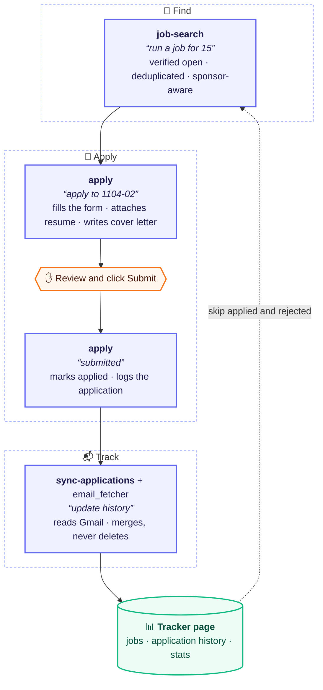

# HayHire

**Finds the needle in the job haystack, and leaves Submit to you.**

*A Claude Code agent harness: job search → apply → email tracking.*

An AI-agent workflow, built on Claude Code skills, that finds visa-friendly entry-level jobs, verifies each one is open on the company's own site, fills applications for human review, and tracks every response from Gmail. A small **harness** connects the steps end to end, and the agent never submits anything: a person reviews every application and clicks Submit.

This repo holds the skills and the harness. The Gmail side lives in its own repo, [email_fetcher](https://github.com/Ari-Da/email_fetcher).

## How it fits together



Gmail is only ever read. The tracker page is a private Claude artifact.

## The harness

`skills/job-pipeline` is the harness. It does not do the work itself; it decides what runs next and owns the handoffs between the other skills:

| Step | Skill | Trigger | Writes |
|---|---|---|---|
| 1. Find jobs | `job-search` | "run a job for 15" | new `jobs` rows |
| 2. Fill an application | `apply` | "apply to 1104-02" | nothing |
| 3. Submit | the person, by hand | clicks Submit | |
| 4. Record it | `apply` | "submitted" | `applied` on the job, a history row |
| 5. Confirm from email | `sync-applications` | "update history" | history rows (merge, never delete) |
| 6. Recruiter stats | `sync-applications` | "update outreach" | outreach rows |

It also answers "pipeline status" and "next". See [harness/README.md](harness/README.md).

## Design decisions

- **Human in the loop.** The agent never clicks Submit, never accepts terms or consent boxes, never creates accounts and never types passwords. LinkedIn and Handshake are read-only.
- **Verified, not scraped.** Every job is confirmed open on the company's own careers site or ATS (Greenhouse, Ashby, Workday APIs), deduplicated across runs, and filtered by sponsorship and graduation-date rules.
- **One writer per collection.** Job search adds jobs, the apply skill marks them and logs submissions, and the email sync only merges into the history. Nothing deletes history rows except the person, by hand.
- **Merge-only sync.** Confirmation emails are matched to logged submissions by company (subsidiaries included), role and date. Unclear matches go to a needs-review list instead of being guessed, and a status only ever moves forward.
- **Privacy first.** Gmail access is read-only and the scope is checked on every token. Recruiter emails are classified by a small local model (Ollama, `llama3.2:3b`), so email text never leaves the machine.

More in [docs/design-decisions.md](docs/design-decisions.md).

## Getting started

```bash
mkdir job-agent && cd job-agent
git clone https://github.com/Ari-Da/hayhire-agent.git public
git clone https://github.com/Ari-Da/email_fetcher.git      # optional: email tracking
./public/install.sh
```

Then open Claude Code and say **"set up job agent"** to answer the [setup questionnaire](#setup-questionnaire).

**Optional: automatic form filling.** Install [Claude in Chrome](https://claude.com/chrome) to let the `apply` skill fill applications automatically. Every form still stops before Submit for review.

| Platform | What `apply` does |
|---|---|
| Greenhouse, Ashby, Lever | Fills the whole form, no sign-in needed |
| Workday, iCIMS, Oracle, SuccessFactors and other portals with accounts | Needs a manual sign-in (or new account) first; after the tab is handed over, it fills the rest |
| LinkedIn, Handshake | Read-only: used to find jobs, never to apply (no Easy Apply) |

Consent boxes, CAPTCHAs and passwords are always done by hand. Without Claude in Chrome, the search, cover letters and email tracking still work.

The tracker page is a private Claude artifact; setup asks for its link.

```text
job-agent/
  public/          this repo: skills, harness, docs, examples (all public)
  email_fetcher/   the Gmail side, its own repo
  private/         your answers, resumes and records; never in any repo
```

The skills are the same files that are published here: they read your details from `private/` (`config.json` and `notes/<skill>.md`), so nothing personal is written into them.

## Setup questionnaire

Before the first search, the `job-agent-setup` skill asks a short questionnaire, a few questions at a time, in plain chat. Answers are saved in `job-agent/private/`, outside every repo, and every skill reads them from there. The quick start takes about 10 minutes; the rest can wait, because `apply` asks when a form needs something missing and remembers the answer.

Start it with:

```text
set up job agent
```

Sample questions:

| Topic | Example questions | Saved to |
|---|---|---|
| 👤 About you | Legal and preferred name? Email, phone, city? Which link goes in a single "links" field? | `apply/profile.md` |
| 🛂 Work authorization | Do you need visa sponsorship now? In the future? Does student work permission count as sponsorship? | `apply/profile.md` |
| 🎓 Education | Which degrees, with dates and GPA? Is the graduation date certain, or could it move? | `apply/profile.md` |
| 🎯 Roles and level | Which roles, in priority order? Which titles should never show up? The most years of experience a posting may ask for? | `notes/job-search.md` |
| 📍 Location | Which cities, in order? Remote, hybrid or on-site? | `notes/job-search.md` |
| 🏢 Companies | Which companies should be checked on every run? Any to skip? | `notes/job-search.md` |
| ✉️ Cover letter *(optional)* | Skip it if no cover letters are wanted. Otherwise: formal, warm or concise? The opening line and experience paragraph? Products genuinely used, for a true personal tie? | `cover-letter/facts.json` |
| ⚙️ Setup | The private tracker page link? Which Chrome is this computer's? Words that must never be published? | `config.json`, `browsers.json`, `blocklist.txt` |

It never asks for passwords, ID numbers or bank details, and it never overwrites an earlier answer without asking. To change an answer later, say "set up job agent" again or just state the new rule. The full list is in [docs/setup-questionnaire.md](docs/setup-questionnaire.md).

## Usage

```text
set up job agent            # first time: the questionnaire
run a job for 15            # up to 15 new verified jobs from the last 14 days
/job-search 20 7            # up to 20 jobs posted in the last 7 days
job run startup 10          # Y Combinator startups that sponsor visas
apply to 1104-02            # fill job 1104-02 and stop before Submit
submitted                   # record it and add it to the history
update history              # read Gmail and merge new responses
pipeline status             # where everything stands
```

## Tests

The Python lives in email_fetcher:

```bash
python -m unittest discover -s tests
```

## Limitations and ethics

- A personal tool for one person's own job search, run on their own computer.
- It respects site terms: it never automates submission, sign-in or account creation, and only reads LinkedIn and Handshake.
- Matching emails to applications is rule-based and sometimes wrong; unclear cases are left for the person to review.
- Companies that send no confirmation email, and replies by phone, are not tracked.

## Keeping it private

`scripts/check_private.py` scans every file and the whole git history against `private/blocklist.txt`, which lives outside the repo, and runs before each commit and push (`scripts/install_hooks.sh`).
